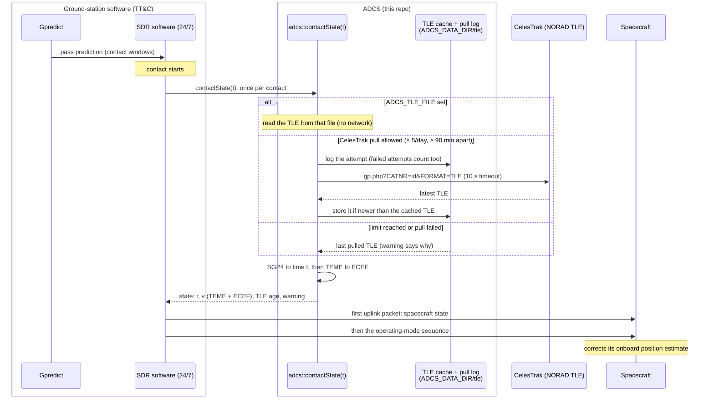
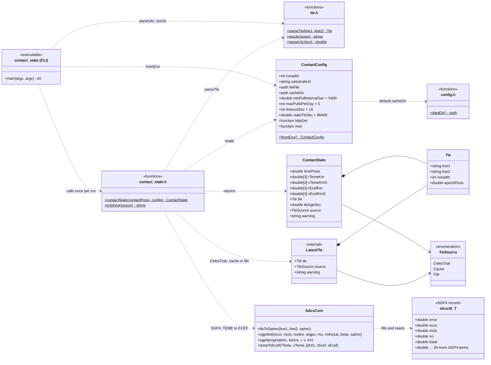

# ADCS Ground Station Software

## About

The ADCS part of the ground-station software: one function the ground station
calls at the start of each contact. It pulls the latest TLE for the spacecraft
from CelesTrak (NORAD data), propagates it with SGP4 to the contact time and
returns the spacecraft state. The ground station uplinks that state before
anything else, and the spacecraft (no GPS on board) uses it to correct its
onboard position estimate.

## Architecture



Inside ADCS, the code is organised as follows. Free functions are shown as
`<<functions>>` boxes named after their header; `adcs_core` is the SGP4 code
originally generated by MATLAB Coder.



| Responsibility | Owner |
| --- | --- |
| Pass prediction, contact windows, contact start and sequencing | Ground-station software (Gpredict, SDR program) |
| Packet format, link errors, remote and unattended operation | TT&C |
| Spacecraft state for the first uplink packet | ADCS: `adcs::contactState` |

The uplink packet layout (frame, units, encoding) belongs in the ICD with Systems
and TT&C. Until it is fixed, the function returns position and velocity in both
TEME (SGP4's native frame) and ECEF, plus the time they apply to.

## Behaviour

- **CelesTrak usage:** at most 5 pulls per day, at least 90 min apart. Every
  attempt counts, including failed ones. The limit is enforced from a log in
  `<ADCS_DATA_DIR>/tle`, so it holds across restarts and processes. An IP ban
  would stop every contact.
- **Unattended (night) contacts:** if a pull is not allowed or fails, the last
  pulled TLE is used and `warning` says why. Network requests time out after
  10 s. The function fails only when no TLE exists at all.
- **Accuracy:** SGP4 gives no uncertainty, so `tle_age_sec` (contact time minus
  TLE epoch) is the proxy. Error is roughly 1 km at epoch and grows by a few km
  per day. A warning is added when the TLE is more than a day from the contact.
  The latest TLE is often many hours old, which is why it is propagated.
- **Before NORAD publishes a TLE** (about 48 h after deployment), set
  `ADCS_TLE_FILE` to a TLE from another source, or use the ISS (25544) as a
  stand-in for an ISS-deployed CubeSat.
- **Validation:** TLE checksums, line consistency and the catalog number are
  checked, and CelesTrak's "No GP data found" reply is rejected. A pulled TLE
  older than the cached one is ignored.

## Build and run

Requirements: CMake 3.20+, a C++17 compiler with OpenMP (GCC/MinGW, Clang or
Visual Studio), and the `curl` program at run time (included with Windows 10+,
macOS and Linux).

```bash
git clone https://github.com/scsd-cdh/ADCS-ground-station-software.git
cd ADCS-ground-station-software/cpp

cmake -B build                       # configure (once)
cmake --build build                  # build
ctest --test-dir build               # run the tests (no network needed)

export ADCS_NORAD_ID=25544
./build/contact_state                        # state now
./build/contact_state 2027-06-01T12:00:00Z   # state at a given UTC time
```

With Visual Studio, build output goes to `build/Release/` (or `build/Debug/`):
use `cmake --build build --config Release` and `ctest --test-dir build -C Release`.

### With Docker

The [Dockerfile](Dockerfile) has a development image with the whole toolchain
(GCC, CMake, Ninja, cpplint), and a deploy image that holds only the compiled
`contact_state` program and curl, with no source or compiler. Only Docker is needed.

```bash
# Development shell, repo mounted at /work (reads .env if present)
docker compose run --rm dev
cmake -S cpp -B /build -G Ninja && cmake --build /build && ctest --test-dir /build

# Deploy image: compiles and runs the tests and style check; the build fails if any fail
docker build -t adcs-contact-state .
docker run --rm -e ADCS_NORAD_ID=25544 -v adcs-data:/data adcs-contact-state
```

Keep the `/data` volume between runs: it holds the TLE cache and the CelesTrak
pull log, so the 5 pulls/day limit holds across containers.

### Style check

C++ follows the Google style, checked by [cpplint](https://github.com/cpplint/cpplint)
with the settings in [cpp/CPPLINT.cfg](cpp/CPPLINT.cfg) (120-column lines;
`cpp/adcs_core`, generated by MATLAB Coder, is excluded). When cpplint is installed,
`ctest` runs it as a test, so style errors fail the test run:

```bash
pip install cpplint==2.0.0
cpplint --recursive cpp
```

## Calling it from the ground-station software

From C++, link `adcs_contact` and call:

```cpp
#include "adcs/contact_state.h"

const adcs::ContactState s = adcs::contactState(contactPosix, adcs::ContactConfig::fromEnv());
// s.rTemeKm, s.vTemeKmS, s.rEcefKm, s.vEcefKmS, s.timePosix, s.tleAgeSec, s.warning
```

From Python (the SDR software), run `contact_state` and read the JSON it prints:

```python
import json, subprocess, time

state = json.loads(subprocess.run(["contact_state", str(time.time())],
                                  capture_output=True, text=True, check=True).stdout)
```

```json
{
  "norad_id": 25544,
  "time_utc": "2026-10-29T02:00:33.775Z",
  "time_posix": 1793239233.775,
  "r_teme_km": [-6382.555586052, -1285.010305773, -1971.504018768],
  "v_teme_km_s": [2.635358919, -4.531624810, -5.577890039],
  "r_ecef_km": [-3623.656240173, 5409.009405431, -1971.504018768],
  "v_ecef_km_s": [-2.788388543, -3.901139778, -5.577890039],
  "tle_line1": "1 25544U 98067A   26301.46699108  .00005372  00000+0  10526-3 0  9998",
  "tle_line2": "2 25544  51.6335   0.5562 0007038 319.9799  40.0670 15.49088092592412",
  "tle_epoch_utc": "2026-10-28T11:12:28.029Z",
  "tle_age_sec": 53285.746,
  "tle_source": "celestrak",
  "warning": ""
}
```

`tle_source` is `celestrak` (pulled now), `cache` (last pull reused) or `file`
(`ADCS_TLE_FILE`). The exit code is 1 with the error on stderr when no state
could be produced.

## Configuration

Environment variables; `.env.example` lists them all.

| Variable | Meaning |
| --- | --- |
| `ADCS_NORAD_ID` | Spacecraft catalog number (required) |
| `ADCS_TLE_SOURCE_URL` | CelesTrak GP endpoint (default `https://celestrak.org/NORAD/elements/gp.php`) |
| `ADCS_TLE_FILE` | Use this TLE file instead of CelesTrak |
| `ADCS_DATA_DIR` | TLE cache and pull log folder (default `<repo>/output`, gitignored) |
